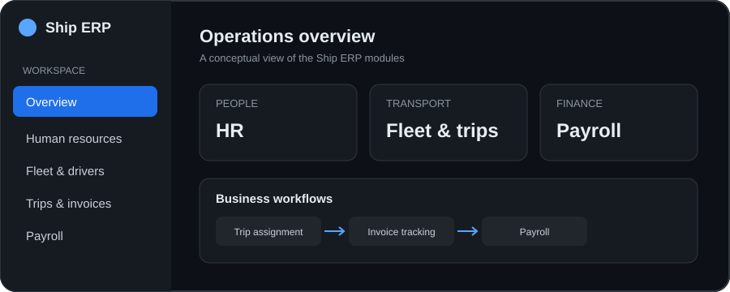

<picture>
  <source media="(max-width: 600px)" srcset="./assets/terminal-intro-mobile.svg">
  
</picture>

 

## About

I'm a **Full Stack Developer** based in Hanoi, Vietnam. I enjoy building practical web applications, designing maintainable interfaces, and learning by shipping projects. Alongside web development, I'm exploring computer vision with Python and strengthening my programming fundamentals with C++.

## Selected work

<blockquote>
  

  ### [Ship ERP — Admin Dashboard](https://github.com/dtv245/Ship-app)

  An ERP administration dashboard for **HR, fleet operations, drivers, trips, invoices, and payroll**. Built around reusable UI components and a feature-oriented application structure.

   

  <small><b>React 18</b> · <b>TypeScript</b> · Refine · Ant Design · Zustand · TanStack React Query · Vite</small>
   
</blockquote>

<blockquote>
  

  ### [FaceNet](https://github.com/dtv245/FaceNet)

  A Python-based computer vision project focused on face-related workflows. Visit the repository to explore the code and implementation details.

   

  <small><b>Python</b> · Computer Vision</small>
   
</blockquote>

<blockquote>
  

  ### [Data Structures & Algorithms](https://github.com/dtv245/cautrucdulieuvagiaithuat)

  C++ practice covering programming problems, core data structures, and algorithmic thinking.

   

  <small><b>C++</b> · Data Structures · Algorithms</small>
   
</blockquote>

## Tech stack

  
<b>More projects</b>

   

  **C++ practice**

  - **[1000 bài code thiếu nhi](https://github.com/dtv245/1000baicodethieunhi)** — a collection of beginner-friendly C++ coding exercises and practice problems.
  - **[Cấu trúc dữ liệu và giải thuật](https://github.com/dtv245/cautrucdulieuvagiaithuat)** — exercises for learning core data structures and algorithms.

  **Web engineering**

  - **[Ship ERP](https://github.com/dtv245/Ship-app)** — an admin dashboard covering workforce, fleet, trips, invoices, and payroll workflows.

  **Computer vision**

  - **[FaceNet](https://github.com/dtv245/FaceNet)** — Python-based face-related computer vision project.

## GitHub activity

 

 

---

