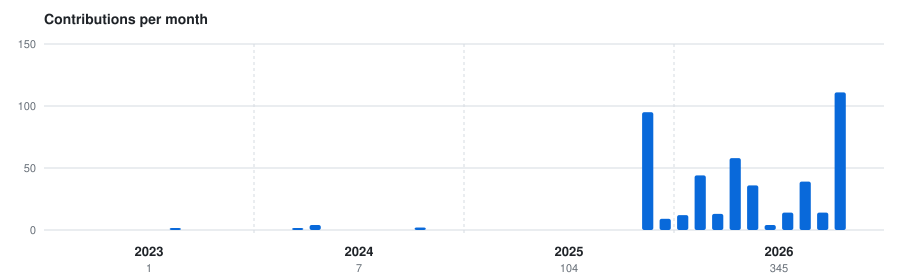
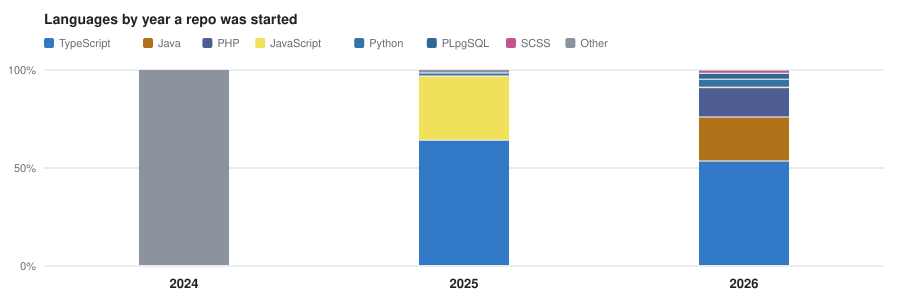

  

  
  
  

## Stack

I build web apps end to end, mostly admin dashboards and business systems, and I keep my C++ and Python fundamentals sharp.

## Selected work

> 
>
> ### [Ship ERP](https://github.com/dtv245/Ship-app)
>
> An admin dashboard for HR, fleet and payroll. It handles multiple tenants and role-based access, moves trips through a state machine (pending, assigned, accepted, started, completed), manages invoices with PDF export, and calculates Vietnamese social insurance and personal income tax for payroll.
>
> **9 modules** · multi-tenant · English and Vietnamese
>
> React 18 · TypeScript · Ant Design · Refine · Vite · Tailwind · [source](https://github.com/dtv245/Ship-app)

**More projects**

**Vision**

- **[FaceNet](https://github.com/dtv245/FaceNet)** is a Python desktop app for webcam face registration and real-time recognition, using MTCNN for detection and TensorFlow FaceNet embeddings.

**Fundamentals**

- **[Data Structures & Algorithms](https://github.com/dtv245/cautrucdulieuvagiaithuat)** contains C++ coursework exercises, including singly linked lists and string processing.
- **[1000 Beginner Coding Exercises](https://github.com/dtv245/1000baicodethieunhi)** is a large collection of standalone C++ programming exercise solutions.

## Activity

  <picture>
    <source media="(prefers-color-scheme: dark)" srcset="assets/timeline-dark.svg">
    
  </picture>
  <picture>
    <source media="(prefers-color-scheme: dark)" srcset="assets/languages-dark.svg">
    
  </picture>

Redrawn daily from the GitHub API by [activity_chart.py](scripts/activity_chart.py).

  

---

Open to Full Stack and Frontend Developer roles, and happy to talk React, TypeScript, ERP dashboards, algorithms or computer vision.

[LinkedIn](https://www.linkedin.com/in/dangthevu-dev) · [Facebook](https://www.facebook.com/blu.vu.520/) · [X](https://x.com/ang_vu24)
